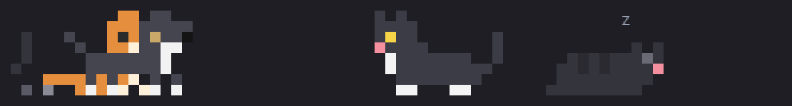

# claude-code-mods

Little mods for the [Claude Code](https://code.claude.com) terminal, by VkaZas. Two draw in the band above the prompt, and they stack: install both and the parade walks above the combo. Two open a pane beside the transcript.

| | Mod | What it does |
| --- | --- | --- |
|  | [**Pixel Parade**](pixel-parade) | Hand-drawn pixel-art cats and dogs wander above the prompt: they stroll, nap, zoom, share hearts and chase each other. Choose how many, and cats, dogs or both. |
|  | [**Typing Combo**](typing-combo) | A fighting-game combo counter: big digits that take a hit on every keystroke, harder the faster you type, with hit-stop, ranks, keys per second and your best. |
| `/side` | [**Side Chat**](vkazas-side) (`vkazas-side`) | A side pane where you talk directly to a subagent forked from the main conversation, while the main conversation keeps working. Its replies stay in the pane until you sync them over. |
| `/ticker` | [**Ticker**](vkazas-ticker) (`vkazas-ticker`) | A live stock pane: a scrolling tape, prices, day change and an intraday sparkline for your watchlist, from Yahoo Finance. |

## Install

At the prompt of a Claude Code terminal session:

```
/plugin install pixel-parade --marketplace VkaZas/claude-code-mods
/plugin install typing-combo --marketplace VkaZas/claude-code-mods
/plugin install vkazas-side --marketplace VkaZas/claude-code-mods
/plugin install vkazas-ticker --marketplace VkaZas/claude-code-mods
```

The first one asks to add the marketplace (`y`), then for a scope. From your shell instead (Claude Code 2.1.292 or later), use `claude plugin install <mod> --marketplace VkaZas/claude-code-mods`. To take a newer version later: `claude plugin update <mod>@vkazas`.

All four were built and tested with Claude Code 2.1.295. None of the mods reads your files (Side Chat's fork is a full subagent, and uses tools as the main conversation does). Only Ticker talks to the network: it fetches your watchlist's quotes from Yahoo Finance while its pane is open.

## 中文

四个 Claude Code 终端小 mod：**Pixel Parade**（提示框上方的像素猫狗巡游）、**Typing Combo**（打字连击）、**Side Chat**（`/side` 侧边分身对话）和 **Ticker**（`/ticker` 实时行情面板）。安装命令同上，在 `/config` 里把 Language 设成 `zh` 就是中文提示。

## License

[MIT](LICENSE)
